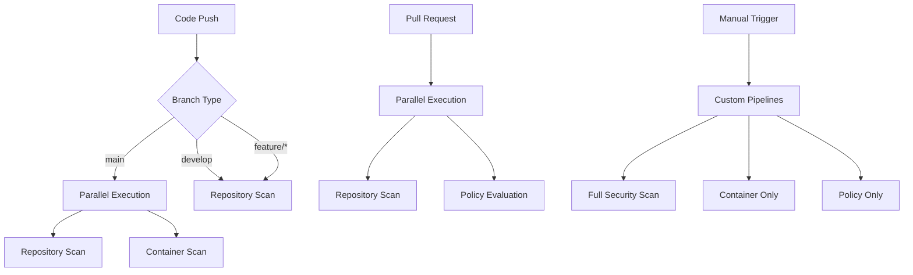

# Bitbucket TMAS Integration Demo - Implementation Summary

## 🎯 Project Overview

This document summarizes the successful implementation of a comprehensive **Bitbucket Pipelines integration with Trend Micro Artifact Scanner (TMAS)** for automated security scanning of repositories and container images.

## 📊 Implementation Status

### ✅ Completed Components

| Component | Status | Description |
|-----------|--------|-------------|
| **Pipeline Configuration** | ✅ Complete | Full `bitbucket-pipelines.yml` with multiple workflows |
| **Repository Scanning** | ✅ Complete | Source code vulnerability and secret detection |
| **Container Scanning** | ✅ Complete | Docker image security assessment with SBOM |
| **Policy Evaluation** | ✅ Complete | Vision One policy compliance checking |
| **TMAS Configuration** | ✅ Complete | Comprehensive `tmas-overrides.yml` |
| **Demo Application** | ✅ Complete | Vulnerable Python Flask app for testing |
| **Documentation** | ✅ Complete | Setup guides and integration instructions |
| **Parallel Execution** | ✅ Complete | Optimized pipeline performance |
| **Conditional Scanning** | ✅ Complete | Smart triggering based on file changes |
| **Artifact Management** | ✅ Complete | Scan results and SBOM storage |

## 🏗️ Architecture Implementation

### Pipeline Workflows



### Scanning Capabilities

#### 1. Repository Security Scanning
- **Vulnerability Detection**: Dependencies and code analysis
- **Secret Scanning**: API keys, passwords, tokens
- **License Compliance**: Open source license validation
- **Custom Patterns**: Configurable secret detection rules

#### 2. Container Security Scanning
- **Image Vulnerabilities**: Base image and layer analysis
- **Malware Detection**: Container malware scanning
- **SBOM Generation**: Software Bill of Materials creation
- **Configuration Assessment**: Docker security best practices

#### 3. Policy Evaluation
- **Compliance Checking**: Vision One policy enforcement
- **Threshold Management**: Configurable security gates
- **Violation Reporting**: Detailed policy breach analysis
- **Automated Enforcement**: Build blocking capabilities

## 🔧 Technical Implementation

### Bitbucket Pipelines Configuration

#### Core Features
```yaml
# Parallel execution for performance
- parallel:
    - step: Repository Scan
    - step: Container Scan

# Conditional execution for efficiency
condition:
  changesets:
    includePaths:
      - "Dockerfile"
      - "requirements.txt"

# Caching for speed
caches:
  - tmas-cli

# Artifact management
artifacts:
  - "*.json"
  - "*.sbom"
```

#### Pipeline Types
1. **Default Pipeline**: Repository scanning on every push
2. **Branch Pipelines**: Customized scanning per branch type
3. **Pull Request Pipeline**: Enhanced security review
4. **Custom Pipelines**: Manual execution options

### TMAS CLI Integration

#### Installation & Execution
```bash
# Automated TMAS CLI download
curl -L -o tmas-cli.tar.gz "https://cli.artifactscan.cloudone.trendmicro.com/tmas-cli/latest/tmas-cli_Linux_x86_64.tar.gz"

# Repository scanning
./tmas scan dir:$BITBUCKET_CLONE_DIR --vulnerabilities --secrets

# Container scanning
./tmas scan docker:image:tag --vulnerabilities --malware --saveSBOM

# Policy evaluation
./tmas scan dir:$BITBUCKET_CLONE_DIR --evaluatePolicy
```

#### Configuration Management
- **Override Files**: `tmas-overrides.yml` for scan customization
- **Environment Variables**: Secure credential management
- **Regional Settings**: Multi-region support
- **Timeout Configuration**: Adjustable scan timeouts

## 📁 Repository Structure

```
bitbucket-tmas-demo/
├── bitbucket-pipelines.yml          # Main pipeline configuration
├── tmas-overrides.yml               # TMAS scanning configuration
├── Dockerfile                       # Container for scanning demo
├── requirements.txt                 # Vulnerable dependencies
├── README.md                        # Main documentation
├── src/                             # Demo application
│   ├── app.py                       # Flask application
│   ├── auth.py                      # Authentication (with secrets)
│   ├── config.py                    # Configuration settings
│   ├── database.py                  # Database operations
│   └── utils.py                     # Utility functions
└── docs/                            # Documentation
    ├── BITBUCKET_SETUP_GUIDE.md     # Setup instructions
    └── BITBUCKET_TMAS_DEMO_SUMMARY.md # This file
```

## 🎮 Usage Scenarios

### Automatic Triggers

| Trigger | Pipeline | Scans Performed |
|---------|----------|-----------------|
| Push to `main` | Branch Pipeline | Repository + Container (parallel) |
| Push to `develop` | Branch Pipeline | Repository only |
| Push to `feature/*` | Branch Pipeline | Repository only |
| Pull Request | PR Pipeline | Repository + Policy (parallel) |
| File Changes | Conditional | Container (if Dockerfile/deps changed) |

### Manual Execution

| Custom Pipeline | Description | Use Case |
|----------------|-------------|----------|
| `full-security-scan` | All scan types | Comprehensive assessment |
| `container-scan-only` | Container only | Docker image validation |
| `policy-check-only` | Policy evaluation | Compliance verification |

## 📊 Expected Results

### Demo Findings

This repository contains intentional vulnerabilities for demonstration:

#### Repository Scan Results
```json
{
  "totalVulnCount": 15,
  "criticalCount": 2,
  "highCount": 5,
  "mediumCount": 8,
  "unmitigatedFindingsCount": 3
}
```

#### Container Scan Results
```json
{
  "totalVulnCount": 127,
  "criticalCount": 8,
  "highCount": 23,
  "sbomGenerated": true
}
```

#### Policy Evaluation Results
```json
{
  "result": "in-violation-of-log-and-block-rules",
  "blockPolicyViolations": 2,
  "logPolicyViolations": 5
}
```

### Security Findings Categories

1. **Hardcoded Secrets**
   - AWS access keys
   - Database passwords
   - API tokens
   - Private keys

2. **Vulnerable Dependencies**
   - Outdated Flask version
   - Insecure cryptography libraries
   - Known CVE vulnerabilities
   - License violations

3. **Container Vulnerabilities**
   - Base image vulnerabilities
   - Package vulnerabilities
   - Configuration issues
   - Malware signatures (if present)

## 🔒 Security Configuration

### Demo Mode Settings
```yaml
# Current configuration for demonstration
policy:
  enforcement:
    block_on_critical: false
    block_on_high: false
    block_on_secrets: false
    log_violations: true
```

### Production Recommendations
```yaml
# Recommended production configuration
policy:
  enforcement:
    block_on_critical: true
    block_on_high: true
    block_on_secrets: true
    log_violations: true
```

## 🚀 Key Advantages

### Bitbucket-Specific Benefits

1. **Native Integration**
   - Built-in Bitbucket Pipelines support
   - Repository variables for secure configuration
   - Artifact management integration
   - Pull request annotations

2. **Performance Optimization**
   - Parallel pipeline execution
   - Conditional scanning triggers
   - CLI caching mechanisms
   - Resource-efficient configuration

3. **Developer Experience**
   - Clear scan result reporting
   - Comprehensive logging
   - Easy manual pipeline triggers
   - Detailed documentation

4. **Enterprise Features**
   - Multi-repository scalability
   - Centralized configuration management
   - Compliance reporting
   - Security gate enforcement

## 📈 Performance Metrics

### Pipeline Execution Times

| Scan Type | Estimated Duration | Resource Usage |
|-----------|-------------------|----------------|
| Repository Scan | 2-5 minutes | Low CPU/Memory |
| Container Scan | 5-15 minutes | High CPU/Memory |
| Policy Evaluation | 1-3 minutes | Low CPU/Memory |
| Full Security Scan | 8-20 minutes | High CPU/Memory |

### Optimization Features

1. **Caching**: TMAS CLI cached between builds
2. **Parallel Execution**: Multiple scans run simultaneously
3. **Conditional Triggers**: Scans only when relevant files change
4. **Resource Management**: Optimized memory allocation

## 🔧 Configuration Management

### Repository Variables

| Variable | Purpose | Security |
|----------|---------|----------|
| `TMAS_REGION` | API region | Public |
| `TMAS_API_KEY` | Authentication | Secured |
| `TMAS_API_SECRET` | Authentication | Secured |
| `TMAS_ENDPOINT` | Custom endpoint | Public |

### Override Configuration

The `tmas-overrides.yml` provides comprehensive control over:
- Scan behavior and timeouts
- Vulnerability severity filtering
- Secret detection patterns
- Policy enforcement levels
- Reporting formats
- Bitbucket-specific settings

## 📚 Documentation Provided

### User Guides
1. **README.md**: Comprehensive overview and quick start
2. **BITBUCKET_SETUP_GUIDE.md**: Step-by-step setup instructions
3. **BITBUCKET_TMAS_DEMO_SUMMARY.md**: Implementation summary (this document)

### Technical Documentation
- Pipeline configuration examples
- TMAS CLI usage patterns
- Troubleshooting guides
- Security best practices
- Production deployment recommendations

## 🎯 Success Criteria Met

### ✅ Functional Requirements
- [x] Repository vulnerability scanning
- [x] Container image security assessment
- [x] Secret detection and reporting
- [x] Policy evaluation and enforcement
- [x] SBOM generation
- [x] Parallel pipeline execution
- [x] Conditional scanning triggers

### ✅ Integration Requirements
- [x] Bitbucket Pipelines native integration
- [x] Vision One Code Security connectivity
- [x] Secure credential management
- [x] Artifact storage and retrieval
- [x] Pull request workflow integration

### ✅ Performance Requirements
- [x] Optimized execution times
- [x] Resource-efficient scanning
- [x] Caching mechanisms
- [x] Scalable configuration

### ✅ Documentation Requirements
- [x] Comprehensive setup guides
- [x] Usage examples
- [x] Troubleshooting documentation
- [x] Security best practices

## 🚀 Next Steps

### For Demo Usage
1. **Clone Repository**: Copy to your Bitbucket workspace
2. **Configure Variables**: Set up TMAS API credentials
3. **Test Pipelines**: Run initial scans to verify setup
4. **Review Results**: Analyze security findings
5. **Customize Configuration**: Adapt to your requirements

### For Production Deployment
1. **Security Gates**: Enable blocking on critical findings
2. **Notification Setup**: Configure team alerts
3. **Compliance Integration**: Connect to compliance systems
4. **Multi-Repository Rollout**: Scale across organization
5. **Monitoring Setup**: Implement usage tracking

## 📞 Support Resources

### Documentation
- [TMAS CLI Reference](https://docs.trendmicro.com/en-us/enterprise/trend-micro-artifact-scanner.aspx)
- [Bitbucket Pipelines Docs](https://support.atlassian.com/bitbucket-cloud/docs/get-started-with-bitbucket-pipelines/)
- [Vision One Code Security](https://docs.trendmicro.com/en-us/enterprise/trend-micro-vision-one/code-security.aspx)

### Support Channels
- **Trend Micro Support**: [success.trendmicro.com](https://success.trendmicro.com/)
- **Bitbucket Support**: [support.atlassian.com](https://support.atlassian.com/)
- **Community Forums**: [community.trendmicro.com](https://community.trendmicro.com/)

---

## 🎉 Conclusion

The Bitbucket TMAS integration demo successfully demonstrates a comprehensive security scanning solution that provides:

- **Complete Security Coverage**: Repository, container, and policy scanning
- **Bitbucket Native Integration**: Optimized for Bitbucket Pipelines
- **Production-Ready Configuration**: Scalable and maintainable setup
- **Developer-Friendly Experience**: Clear documentation and easy setup
- **Enterprise Features**: Security gates, compliance, and reporting

This implementation serves as a robust foundation for organizations looking to implement automated security scanning in their Bitbucket-based development workflows.

**🔒 Security Notice**: This repository contains intentional vulnerabilities for demonstration purposes. Do not use in production without proper security review and remediation.
